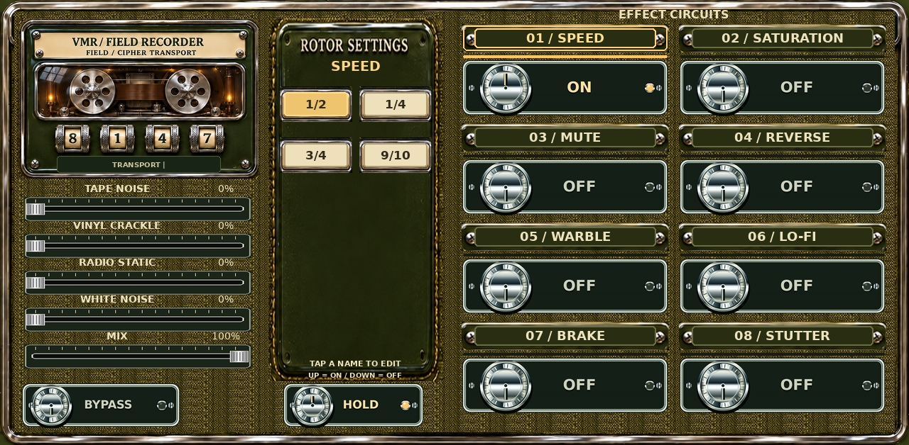
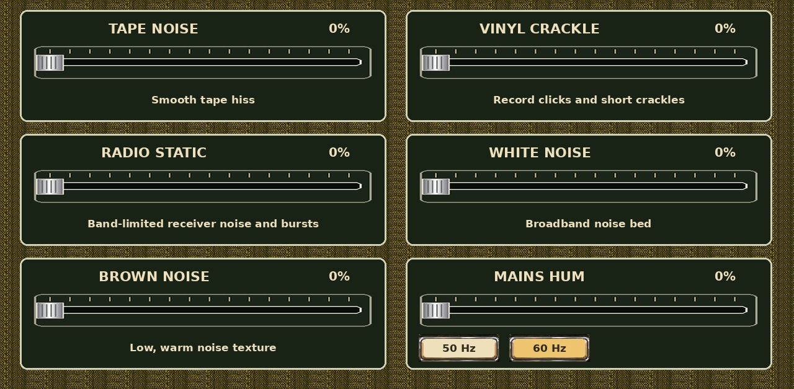

# Vintage Military Radio

**v1.0.14** · Stereo tape performance effect and procedural sound textures by **Tropix R!X Crazy Jungle Sounds** · MIT.

[Download v1.0.14](https://github.com/vulnerablecodes/music-production/releases/tag/v1.0.14) · [Eight-effect GIF](media/vintage-military-radio-eight-effects.gif) · [MP4 showcase](media/vintage-military-radio-eight-effects.mp4)

Eight independent performance circuits: **Speed, Saturation, Mute, Reverse, Warble, Lo-Fi, Brake and Stutter**. Large machined chrome rotary switch knobs use **UP = ON / DOWN = OFF**. Tap a nameplate to select its Rotor Settings; enable state stays independent of selection. HOLD switches between latched and momentary circuit operation. Decorative cipher barrels are not audio controls.

## Noise and sound layers

The main page has **Tape Noise, Vinyl Crackle, Radio Static, White Noise and Mix** sliders. **SOUNDS** adds large sliders for all six sources, including **Brown Noise** and **Mains Hum**, with **50/60 Hz** selection. All new sound layers default to **0%**, synthesize locally without samples or downloads, and follow wet Mix, Mute and Bypass.

## Downloads and installation

For **MPC XL / Gen2 with MPC OS 3.10.1+**, the **SDK-aarch64.zip** is the direct folder-copy package. Enable Enhancements and External Plugin Support, extract it, and copy the complete **Vintage Military Radio** folder into **VST2 Plugins** at the drive root. Keep one installed copy of UID `VMR8` across connected drives. Replace the previous radio folder, fully restart MPC, then load it in an insert FX slot. The original Crazy Cassette remains a separate plugin identity.

The **mpc-aarch64.zip** and **mpc-armv7.zip** assets are OpenMPC catalog installers. Follow the included `INSTALL.md` or use the catalog installer; their required portable wrapper and vendor-named internal folder differ from the SDK folder-copy ZIP. The source-and-both-architectures ZIP contains the simple-name SDK plugin folder, both binaries, source, build tools, skins, previews and verification logs. `SHA256SUMS.txt` lists release file digests.

## Verification and limits

Native, ARM32 and ARM64 builds completed. The native host simulator passed **20 checks**; SDK validation reports **0 errors / 0 warnings**. All **16 mode/HOLD** touch-layout combinations and exact sprite dimensions pass. Texture tests cover all five new layers, zero defaults, independent output, dry Mix, Mute, Bypass and combined output bounds. Both catalog ZIPs pass `catalog_check.py --catalog --require-portable` with **0 warnings**.

The reel clock advances without audio processing and passes idle, bypass, suspend/resume and teardown tests. Reel drawing now uses read-only native filmstrip controls and a native Value subscriber. **v1.0.14 physical MPC repaint behavior and the new sound layers remain unverified.** Earlier owner reports establish prior-version UI loading; they do not verify this release. Gen1/Force hardware and device CPU usage have not been tested. The GIF/MP4 shows assembled UI assets, **not an on-device recording or audio demonstration**.

## Source and license

Editable project source is under [plugin/](plugin/). Build with the inMusic MPC Plugin Builder SDK: build native to emit parameter metadata, run `make_chrome_skin.py`, then build all targets and run `release.py`. Preserve `VMR8` and the parameter index order. [Revision history](plugin/revisions.txt) records changes newest first. The SDK and community helper license notices are retained; no third-party manufacturer logo, proprietary sample content, or firmware files are distributed.
