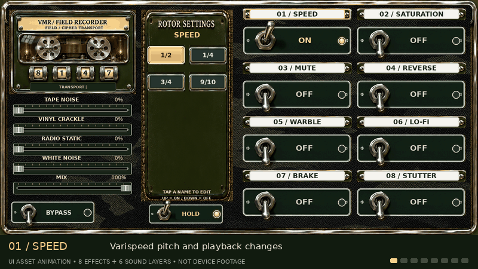

# Vintage Military Radio — FIELD / CIPHER Chrome

**v1.0.9** · Eight stereo tape effects by **Tropix R!X Crazy Jungle Sounds**.

v1.0.9 test package prepared; release publication pending device test. · [MP4 showcase](media/vintage-military-radio-eight-effects.mp4)

Original olive canvas and polished chrome artwork, ivory keys, amber indicators and animated reels. Speed, Saturation, Mute, Reverse, Warble, Lo-Fi, Brake and Stutter operate independently. Select an effect title to show its settings; ENGAGE activates it; HOLD changes latching/momentary behavior. NOISE and MIX use horizontal faders. Cipher barrels are decorative. The silent animation demonstrates UI assets, not a recording from MPC hardware.

## Installation and the Effects tab

Use MPC OS 3.10.1 or newer with Enhancements and External Plugin Support enabled. Extract the installer for your architecture and copy the entire `Vintage Military Radio` folder directly into `VST2 Plugins` at the drive root.

Keep one installed copy of each plugin UID across connected drives. Remove earlier copies of the radio design installed under its old name. **Fully restart MPC after copying**, then select it from an audio track/program/mixer **insert FX** slot and the Effects / External Plugins browser.

Vintage Military Radio uses the distinct UID `VMR8` and binary filenames `vintage-military-radio-arm32.so` / `vintage-military-radio-arm64.so`. Both manifest and binary explicitly identify a stereo effect, with no instrument or MIDI flag. A separately retained local plugin can coexist under its own UID.

## Verification and source

ARM32, ARM64 and native builds completed. SDK validation reports zero errors or warnings; the native host simulator passed 20 checks. Device testing confirms separate effect discovery in v1.0.8. The v1.0.9 short-folder skin lookup remains pending physical MPC testing.

The source-and-both-architectures release includes the SDK framework/tools, generated skins, source, verification logs and revision history. Its project is under `Source/mpc-plugin-builder-sdk/plugins/Vintage Military Radio`. Use the SDK build tools to build native, run `make_chrome_skin.py`, then build all targets and run `release.py`. This repository keeps the editable project source and master artwork; generated installable assets are in the release.
