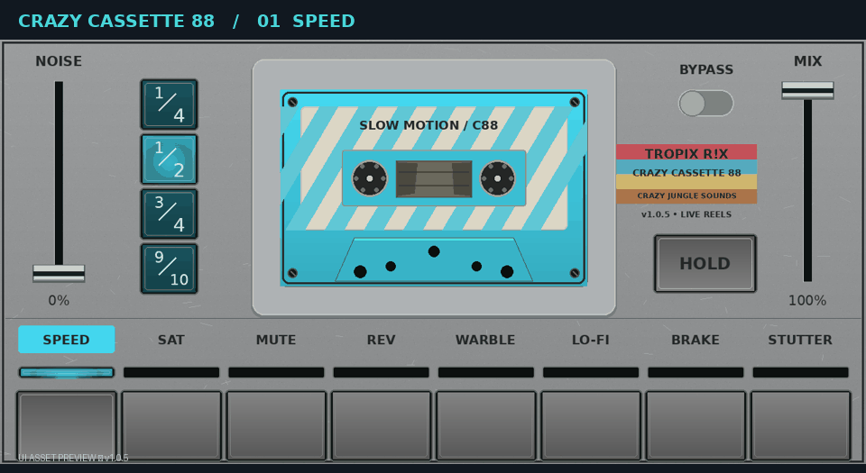

> **Downloads:** Both ARM32/Gen1 and ARM64/Gen2 installer ZIPs and checksums are available in the [v1.0.5 Release](https://github.com/vulnerablecodes/music-production/releases/tag/v1.0.5). The complete SDK folder-copy ZIP is also at the repository root. Use those packages for installation; the expanded source tree does not contain standalone compiled libraries.

<div align="center">

# 📼 Crazy Cassette 88
### Eight effects. One cassette playground.
**Tropix R!X Crazy Jungle Sounds · v1.0.5 “LIVE REELS”**

  

Turn a clean loop into a half-speed daydream, a dusty tape sketch, or a chopped-up jungle break. Crazy Cassette 88 puts eight independent stereo effects behind a colorful cassette interface built for hands-on performance on MPC standalone.



**SPEED · SATURATION · MUTE · REVERSE · WARBLE · LO-FI · BRAKE · STUTTER**

[Watch MP4](media/all-eight-effects.mp4) · [Install](#installation) · [Source](Source/mpc-plugin-builder-sdk/plugins/Crazy%20Cassette%2088) · [Revision history](revisions.txt)

</div>

The 13.6-second animation cycles through all eight shipped effect views, with each mode selected and its indicator lit. It is an illustrative UI asset preview, without audio; it is not a recording of an MPC session. The optimized legacy [moving-reel preview](Speed-reels-preview.gif) is also included.

## Shape the loop

| Effect | What it brings to your performance |
|---|---|
| **Speed** | Pitch-lowering varispeed at 1/4, 1/2, 3/4 and 9/10. |
| **Saturation** | Boost, Amp and Drive coloration with adjustable drive. |
| **Mute** | Smoothed wet-path cuts; set Mix to 100% for full silence. |
| **Reverse** | Backward buffered chunks at 1/8, 1/4, 1/2 and one bar. |
| **Warble** | Seven wow/flutter/drift combinations plus depth control. |
| **Lo-Fi** | Dust, Cassette, Narrow, 8-bit, 6-bit, 4-bit, Broken and Telephone. |
| **Brake** | Tape-style slowdown to silence over 1/8, 1/2, 1 or 2 quarter-note beats. |
| **Stutter** | Rhythmic frozen repeats from 1/2 down to 1/64, with triplets and repeat wear. |

Stack effects independently. Tap a mode name to view its cassette and variations, then use the large pad beneath it to engage the effect. HOLD latches the touchscreen controls; with HOLD off, touch gestures release the effect. PERFORM, CHARACTR and EXTRAS group the performance and sound-shaping controls. Q-Link mappings, host automation and project parameter recall are included.

Eight starting presets: **Clean, Dusty Deck, Half Speed, Quarter Dream, Jungle Crunch, Reverse Dub, Flutter Reel and Stutter 16**.

## LIVE REELS

Version 1.0.5 adds explicit host notifications for continuous reel updates. SPEED engages the visual motor, Reverse changes its direction, and Brake slows it toward a stop. Speed off or plugin Bypass freezes the reels. The small UI counter helps identify redraw activity.

**Hardware report:** the owner confirmed v1.0.5 fully working on **MPC XL (Gen2), MPC OS 3.10.1**, including continuous cassette animation. ARM32 is included but remains untested on Gen1 hardware. Earlier verification notes describe the pre-hardware-test state and are retained as historical records.

## Installation

1. Copy the complete **Tropix R!X Crazy Jungle Sounds - VST - Crazy Cassette 88** folder into **VST2 Plugins** at the root of your MPC-accessible drive.
2. Use **MPC OS 3.10.1 or later**. Enable **Preferences → Enhancements (Beta) → Enable Enhancements** and **External Plugin Support**.
3. Reconnect the drive or restart the MPC as needed. Choose **Crazy Cassette 88** under **External Plugins** in an insert-effect slot.
4. Start with **Clean**, play audio through the insert, and engage a mode. Reverse and Stutter need preceding audio in their buffers.

Native skins and installation instructions are included. Get the ARM32/ARM64 libraries from the release packages or complete root SDK ZIP. This package is for MPC standalone; desktop AU/VST3 builds are not included.

## Catalog release assets

The prepared package includes separate OpenMPC installer ZIPs for Gen1 (`armv7`) and Gen2 (`aarch64`). Both passed the current catalog checker with nine advisory tall-image warnings each. Hardware verification applies to Gen2 only. The normal SDK folder-copy installation above remains available. The catalog entry and release assets are prepared; the installer ZIPs are published in the v1.0.5 Release and [OpenMPC PR #893](https://github.com/open-mpc/mpc-vst-plugins/pull/893) is open.

## Inside the package

| Folder / file | Contents |
|---|---|
| Plugin folder | Native interface assets and metadata; compiled binaries are supplied in the release/root SDK ZIP |
| `Source/` | SDK snapshot, plugin C++ source, skin generator and tests |
| `Verification/` | Existing build, DSP, spectral, sanitizer and UI test records |
| `Previews/` and `media/` | All eight interface views, animated GIF and MP4 |
| `DEVELOPMENT-NOTES.md` | Detailed controls, signal path, rebuild instructions and historical limitations |
| `revisions.txt` | Full newest-first development history |

## Build and verification

From `Source/mpc-plugin-builder-sdk`, run:

```sh
python3 tools/build.py "plugins/Crazy Cassette 88"
python3 tools/package.py "plugins/Crazy Cassette 88"
```

The included verification records cover native host/state/audio checks, DSP behavior, speed ratios, reel updates and ARM validation. No new audio algorithm or binary is introduced by this documentation/media upload. See the [technical notes](DEVELOPMENT-NOTES.md) for test details and approximation limits. Varispeed is a granular real-time approximation; saturation is not oversampled; transient audio buffers are not saved with projects. Manage Output to avoid clipping.

## Credits and license

Original DSP and graphics: **Tropix R!X Crazy Jungle Sounds**, MIT. Built with the [official inMusic MPC Plugin Builder SDK](https://github.com/inmusic-software/mpc-plugin-builder-sdk); its MIT license and the OpenMPC reference attribution are preserved in the source tree. Fly Tape II was a feature/layout reference; this project uses original code and graphics and claims no sonic equivalence or endorsement. Akai, inMusic and other referenced marks belong to their owners.
